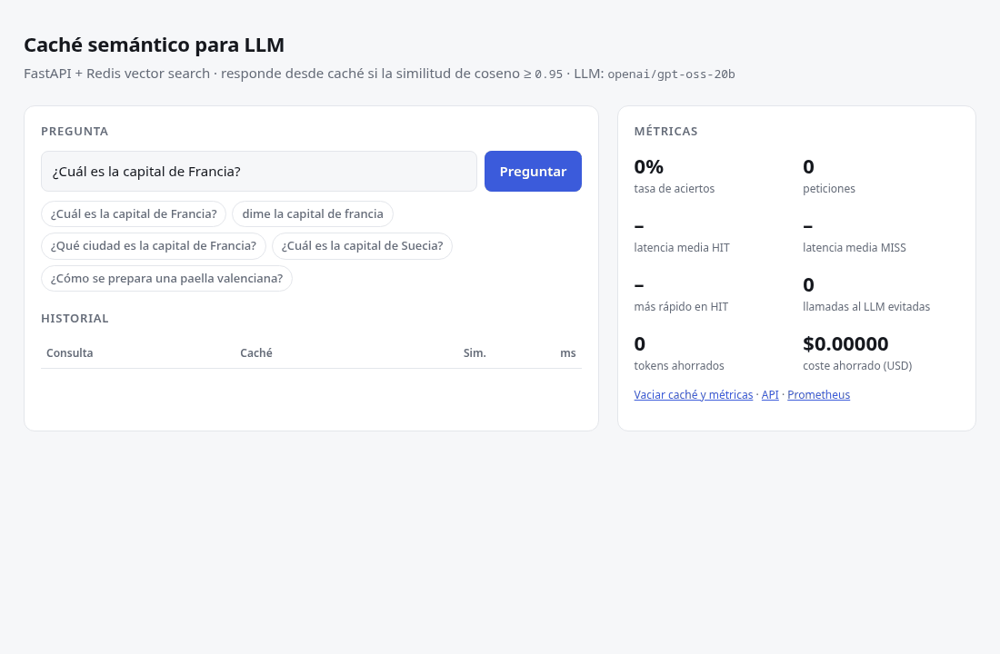

# Caché semántico para LLM · FastAPI + Redis

[](https://github.com/galvysRodriguez/semantic-cache/actions/workflows/ci.yml)


Middleware para FastAPI que intercepta preguntas dirigidas a un LLM (Gemini) y, si ya se respondió
una **semánticamente equivalente**, devuelve la respuesta guardada en Redis en milisegundos en lugar
de volver a pagar la llamada.



| Bajo carga (50 usuarios, 60 s) | sin caché | con caché |
|---|---:|---:|
| Throughput | 26 req/s | **88 req/s** |
| Latencia p50 | 1500 ms | **45 ms** |
| Latencia p50 preguntas repetidas o parafraseadas | 1500 ms | **37 ms** |
| Peticiones que llegan al LLM | 100 % | **10 %** |

## Cómo funciona

```
POST /ask {"query": "dime la capital de francia"}
        │
        ▼
SemanticCacheMiddleware (ASGI puro)
  1. normaliza: minúsculas, sin tildes ni puntuación
  2. ¿misma consulta exacta? ──── HMGET por clave sha256 ─────────────► HIT  (~1 ms)
  3. embedding local (MiniLM multilingüe, ONNX, 384 dims)
  4. KNN 3 en índice HNSW COSINE de Redis
       └─ similitud ≥ 0.95 y mismos números/IDs ─────────────────────► HIT  (~15-30 ms)
  5. ¿la misma consulta ya está en vuelo? ── espera su respuesta ─────► HIT  (single-flight)
  6. si no: llama a Gemini, guarda la respuesta 2xx con TTL ──────────► MISS (~1-3 s)
```

Cada respuesta indica qué pasó: `X-Cache: HIT|MISS`, `X-Cache-Similarity`, `X-Cache-Matched-Query`,
`X-Cache-Latency-Ms` y, en un HIT, `X-Cache-Saved-Tokens` / `X-Cache-Saved-Usd`.

## Puesta en marcha

```bash
cp .env.example .env            # añade GEMINI_API_KEY (sin ella se usa un LLM simulado)
docker compose up --build       # o: podman compose up --build
```

- Demo: http://localhost:8000
- API (Swagger): http://localhost:8000/docs
- Métricas: http://localhost:8000/stats (JSON) y http://localhost:8000/metrics (Prometheus)

La imagen ya incluye el modelo de embeddings, así que arranca en segundos y no necesita red
salvo para llamar a Gemini.

## Decisiones y aprendizajes

Las cosas que no salen en un tutorial, encontradas midiendo:

**1. El modelo distingue mayúsculas y tildes.** "¿Cuál es la capital de Francia?" frente a
"dime la capital de francia" daba **0.876**, por debajo del umbral, y el usuario no veía el HIT.
Normalizar el texto antes del embedding lo sube a **0.968**. Las variantes que solo cambian en la
escritura pasan a ser la misma clave y se resuelven sin calcular el embedding.
→ `tests/test_real_similarity.py`

**2. El modelo apenas distingue números: un falso positivo peligroso.** Lo encontré durante la
prueba de carga. "Estado del pedido 10023" frente a "Estado del pedido 10024" da **0.964**, así que
el caché le habría dado a un cliente el estado del pedido de otro. Ahora un HIT semántico exige que
los tokens con dígitos (IDs, cantidades, años) coincidan exactamente. La búsqueda trae los 3 vecinos
más cercanos para que un vecino descartado no oculte uno válido.
→ `test_different_ids_never_share_an_answer`, `test_end_to_end_numbers_never_hit`

**3. Por qué el umbral está en 0.95, y no más bajo.** Las preguntas sobre temas distintos quedan
lejos, ≤ 0.66 ya normalizadas. Pero las que solo cambian una palabra se acercan mucho: "traduce
'hola' al inglés" frente a "traduce 'adiós' al inglés" da **0.935**. Por eso no bajé el umbral,
aunque así se pierden paráfrasis con otras palabras ("¿cuánta población tiene España?" frente a
"¿cuántos habitantes…?", 0.78). Es deliberado: un MISS de más cuesta una llamada al LLM, pero un
HIT de más devuelve una respuesta incorrecta. Los tests marcan estos casos como límites conocidos
(`xfail`).

**4. Peticiones simultáneas a lo mismo (cache stampede).** Si 10 usuarios hacen la misma pregunta
nueva a la vez, sin protección se hacen 10 llamadas al LLM. Un lock `SET NX PX` en Redis deja pasar
a una sola petición y el resto espera su respuesta. Si esa petición falla, las que esperan llaman
ellas mismas al LLM en vez de quedarse colgadas.
→ `test_concurrent_identical_requests_call_backend_once`

**5. El coste del caché: el embedding en CPU.** Bajo carga, las preguntas nuevas tardan algo más
con caché (p50 1.7 s frente a 1.5 s) porque cada una paga un embedding y compite por CPU. Si el
tráfico tuviera pocas repeticiones, el caché no compensaría. Para ese caso, los siguientes pasos
serían un modelo de embeddings en GPU o un servicio aparte.

**Otras decisiones:**
- **ASGI puro**, no `BaseHTTPMiddleware`: lee y reinyecta el body sin overhead y captura la
  respuesta para guardarla.
- **Aislamiento por tenant** (`X-Tenant-ID`) y por endpoint, para que las respuestas de un cliente
  no se sirvan a otro.
- **Tolerante a fallos**: si Redis cae, el middleware deja pasar la petición al LLM.
- **Solo se cachean las respuestas 2xx**, con TTL configurable por ruta.
- **Métricas en Redis**, compartidas entre réplicas, además de Prometheus por proceso.

## API

| Método | Ruta | |
|---|---|---|
| `POST` | `/ask` | `{"query": "..."}` → respuesta de Gemini, cacheada |
| `GET` | `/stats` | tasa de aciertos, latencias, tokens y USD ahorrados |
| `DELETE` | `/stats` | reinicia las métricas |
| `DELETE` | `/cache?path=/ask` | invalida una ruta para el tenant de la petición (sin `path`: todo) |
| `GET` | `/metrics` | formato Prometheus |
| `GET` | `/health` | estado de Redis y backend LLM activo |

## Configuración (`.env`)

| Variable | Por defecto | |
|---|---|---|
| `GEMINI_API_KEY` | – | sin ella se usa el backend simulado |
| `SEMCACHE_GEMINI_MODEL` | `gemini-2.5-flash` | |
| `SEMCACHE_SIMILARITY_THRESHOLD` | `0.95` | |
| `SEMCACHE_TTL_SECONDS` | `3600` | 0 = sin expiración |
| `SEMCACHE_ROUTE_TTLS` | `{}` | p. ej. `{"/news": 300}` |
| `SEMCACHE_CACHED_PATHS` | `["/ask"]` | rutas interceptadas |
| `SEMCACHE_TENANT_HEADER` | `x-tenant-id` | |
| `SEMCACHE_ENABLED` | `true` | `false` para medir la línea base |
| `SEMCACHE_PRICE_INPUT_PER_MTOK` / `_OUTPUT_` | `0.30` / `2.50` | USD por millón de tokens, para estimar el ahorro |

## Desarrollo

```bash
python -m venv .venv && .venv/bin/pip install -r requirements-dev.txt
docker compose up -d redis

.venv/bin/pytest                    # 65 tests: middleware, modelo real e integración con Redis
.venv/bin/ruff check . && .venv/bin/mypy
.venv/bin/uvicorn app.main:create_app --factory --reload
```

Prueba de carga (los resultados están en `loadtest/results/`):

```bash
locust -f loadtest/locustfile.py --host http://localhost:8000 --headless -u 50 -r 10 -t 60s
```

El tráfico simulado es un 90 % de preguntas conocidas (con variantes de escritura y paráfrasis) y un
10 % de preguntas nuevas. El backend simulado tarda 1.5 s, para no gastar cuota de Gemini al medir.

## Estructura

```
app/
  middleware.py   intercepción ASGI, normalización, single-flight
  cache.py        índice vectorial Redis, búsqueda KNN, guard de entidades, invalidación
  embeddings.py   embeddings locales (fastembed / ONNX)
  llm.py          backend Gemini y backend simulado
  stats.py        métricas en Redis y Prometheus
  main.py         app FastAPI
  static/         página de demo
tests/            unitarios (embeddings falsos) e integración (modelo real y Redis)
loadtest/         escenario de Locust y resultados
scripts/          benchmark rápido y grabación del GIF
```
